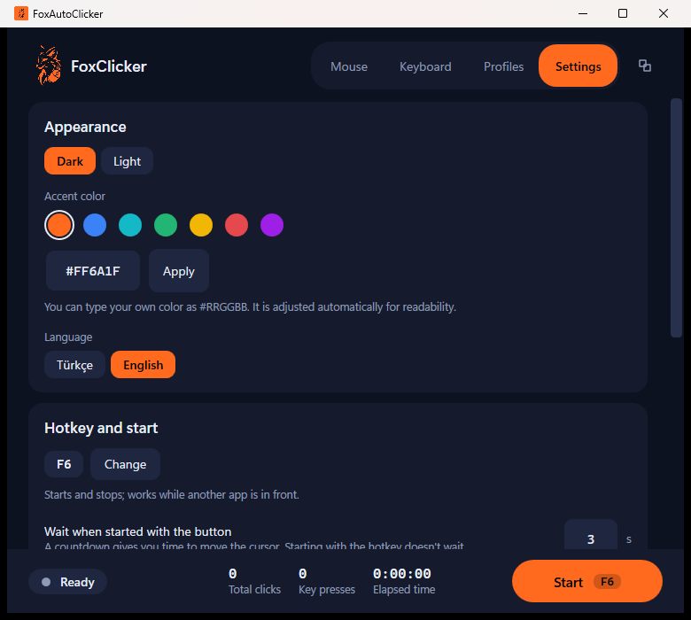
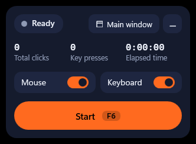

<div align="center">

# FoxClicker

**A simple, good-looking auto clicker for mouse and keyboard on Windows.**

English · [Türkçe](README.tr.md)

[**Download the latest release**](https://github.com/foxezol/foxautoclicker/releases/latest)


</div>

## Features

**Mouse**
- Left, middle or right button; single click, double click or **hold**
- Intervals from hours down to milliseconds, with **Fast / Normal / Slow** presets (50 ms, 250 ms, 1 s) or any custom value
- Optional random jitter so the rhythm feels natural
- Repeat until stopped, or a fixed number of times
- Click where the cursor is, or at a fixed position. **Pick position** dims the screen and draws guide lines from every edge to your cursor; click to choose, Esc to cancel

**Keyboard**
- Build a key sequence one key at a time, or press **Start key recording** and just type it
- Edit the sequence: move keys left or right, remove one, undo the last, clear all. The app's own hotkey is never recorded
- **Press and release** (each round runs the whole sequence) or **hold** the keys down until you stop
- Same interval and repeat options as the mouse

**Everything else**
- One global **start/stop hotkey** (F6 by default, changeable) that works while another app is in front
- A visible **countdown** (with cancel) when you start from the button, so you can move the cursor first
- Short **start and stop sounds**, so you can hear that it is working
- **Profiles**: save mouse and keyboard settings together, load them in one click
- A small always-on-top **mini window** with the same controls and counters
- Dark and light themes, seven accent colors or your own `#RRGGBB`
- English and Turkish
- **Automatic updates** from GitHub Releases, with a *Update now / Later* prompt

<div align="center">




</div>

## Install

Download one of these from the [latest release](https://github.com/foxezol/foxautoclicker/releases/latest):

| File | What it is |
|---|---|
| `FoxClicker-win-Setup.exe` | Installer. Installs for your user (no admin needed), adds shortcuts, and keeps itself updated. |
| `FoxClicker-win-Portable.zip` | Portable. Unzip anywhere and run `FoxClicker.exe`. Updates work here too. |

Windows 10 or 11 (64-bit). The .NET runtime is bundled, so there is nothing else to install.

> The installer is not code-signed, so Windows SmartScreen may warn you the first time.
> Click **More info**, then **Run anyway**.

## Use

1. Pick **Mouse**, **Keyboard**, or both. Use the switch at the top right of each tab.
2. Set the interval and where to click or which keys to press.
3. Press **F6** (or the Start button). Press it again to stop.

Settings are stored in `%AppData%\FoxAutoClicker\settings.json`.

## Updates

Under **Settings → Updates** you can turn on the automatic check at startup, or check manually. When a new version is out, FoxClicker asks whether to update now or later. Updating downloads the new version and restarts the app.

## A note on games

Many online games and anti-cheat systems detect and ban automated input. FoxClicker does not hide itself. Use it only where automation is allowed.

## Build from source

You need the [.NET 10 SDK](https://dotnet.microsoft.com/download).

```powershell
git clone https://github.com/foxezol/foxautoclicker
cd foxautoclicker
dotnet run -c Release
```

To build the installer and portable zip ([Velopack](https://velopack.io)):

```powershell
dotnet publish -c Release -r win-x64 --self-contained -p:PublishReadyToRun=true -o publish
dotnet tool install -g vpk
vpk pack --packId FoxClicker --packVersion 0.3.0 --packDir publish --mainExe FoxAutoClicker.exe --icon Assets/app.ico --runtime win-x64 --outputDir Releases
```

Upload everything in `Releases/` to a GitHub release tagged `v0.3.0` so installed copies can find the update.

## Credits

Made by [foxezol](https://github.com/foxezol), built with Claude Code.

## License

See [LICENSE](LICENSE).
