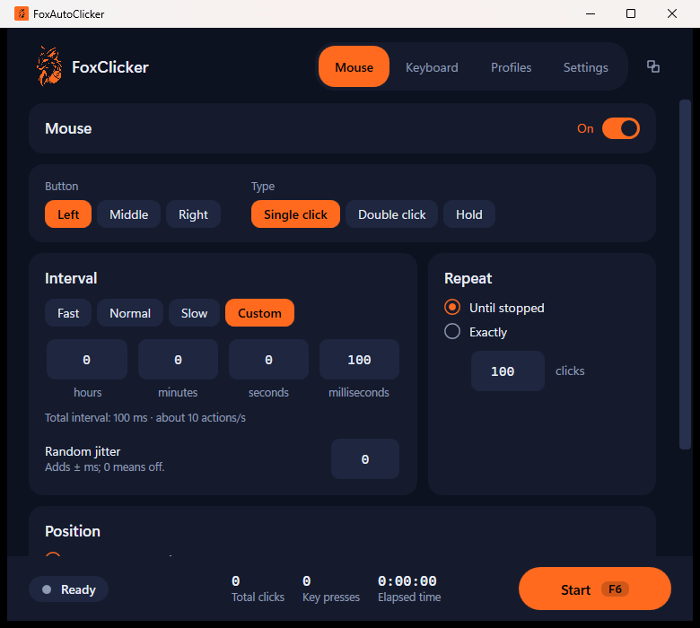
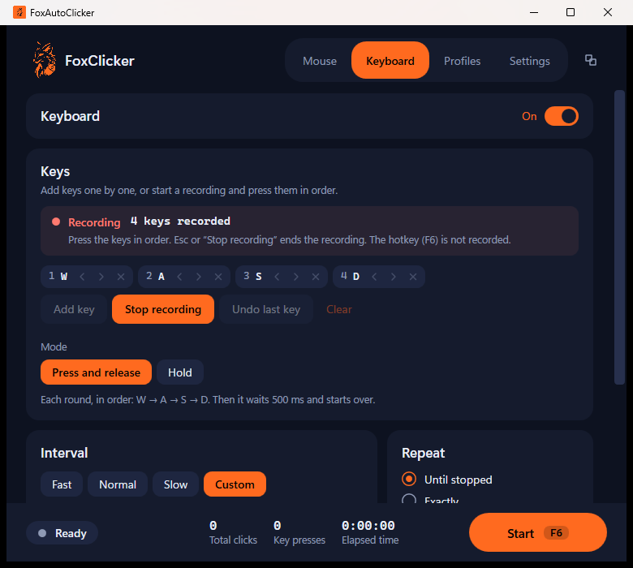
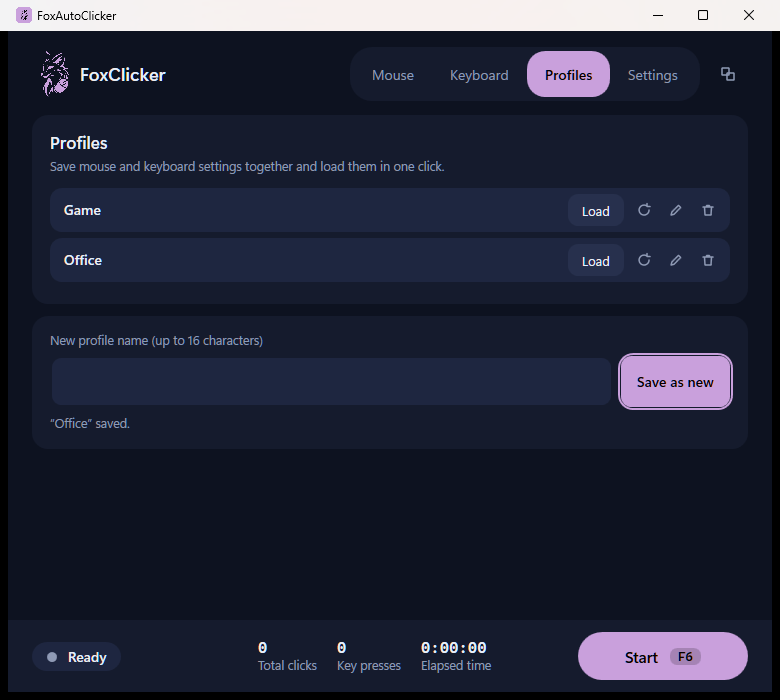
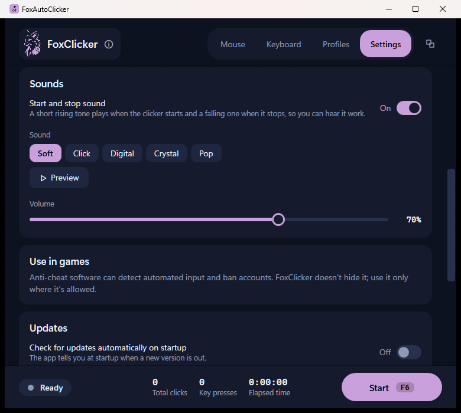
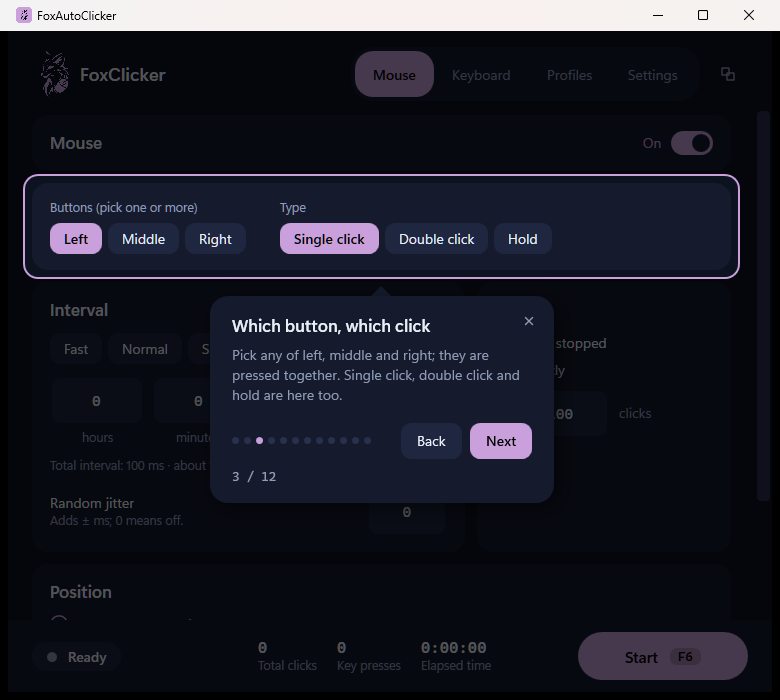
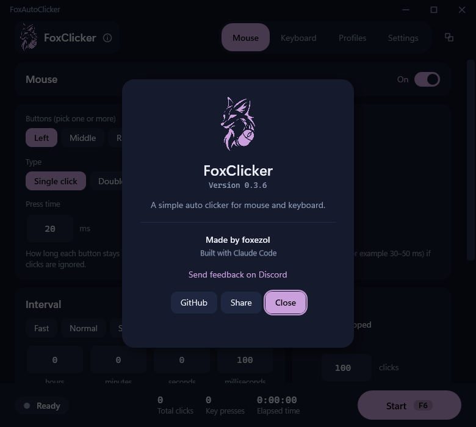

<div align="center">

# FoxClicker

**A simple, good-looking auto clicker for mouse and keyboard on Windows.**

English · [Türkçe](README.tr.md)

[**Download the latest release**](https://github.com/foxezol/foxautoclicker/releases/latest)



</div>

## Features

**Mouse**
- Left, middle and right buttons: pick any combination and they are pressed together. Single click, double click or **hold**
- Intervals from hours down to milliseconds, with **Fast / Normal / Slow** presets (50 ms, 250 ms, 1 s) or any custom value
- Optional random jitter so the rhythm feels natural
- Repeat until stopped, or a fixed number of times
- Click where the cursor is, or at a fixed position. **Pick position** dims the screen and draws guide lines from every edge to your cursor; click to choose, Esc to cancel

**Keyboard**
- Build a key sequence one key at a time, or press **Start key recording** and just type it
- Edit the sequence: move keys left or right, remove one, undo the last, clear all. The app's own hotkey is never recorded
- **Press and release** (each round runs the whole sequence) or **hold** the keys down until you stop
- Same interval and repeat options as the mouse

**Everything else**
- One global **start/stop hotkey** (F6 by default; the app asks you to confirm or change it on first launch) that works while another app is in front
- A visible **countdown** (with cancel) when you start from the button, so you can move the cursor first
- **Start and stop sounds** in five styles (Soft, Click, Digital, Crystal, Pop) with a preview button and a volume slider, so you can hear that it is working
- A guided **tour** for new users: it dims the screen, frames each part and explains it in a sentence. Restart it any time from Settings
- **Profiles**: save mouse and keyboard settings together, load them in one click
- A small always-on-top **mini window** with the same controls and counters
- Dark and light themes, a lavender accent by default, seven more accent colors or your own `#RRGGBB`. The window and taskbar icon follow the accent
- English and Turkish
- **Automatic updates** from GitHub Releases, with an *Update now / Later* prompt
- **Reset settings** and **Uninstall** buttons in Settings

<div align="center">






</div>

## Install

Download one of these from the [latest release](https://github.com/foxezol/foxautoclicker/releases/latest):

| File | What it is |
|---|---|
| `FoxClicker-Setup-x.y.z.exe` | Installer wizard. Choose the install folder, the Start Menu folder and whether to add a desktop shortcut. On the last page you can tick *Launch FoxClicker* and *Open the FoxClicker page on GitHub* (both ticked by default, untick what you don't want). No admin rights needed unless you choose an all-users install. |
| `FoxClicker-Portable-x.y.z.zip` | Portable. Unzip anywhere and run `FoxAutoClicker.exe`. |

Windows 10 or 11 (64-bit). The .NET runtime is bundled, so there is nothing else to install.

> The installer is not code-signed, so Windows SmartScreen may warn you the first time.
> Click **More info**, then **Run anyway**.

## Use

1. Pick **Mouse**, **Keyboard**, or both. Use the switch at the top right of each tab.
2. Set the interval and where to click or which keys to press.
3. Press **F6** (or the Start button). Press it again to stop.

Settings are stored in `%AppData%\FoxAutoClicker\settings.json`.

## Updates

Under **Settings → Updates** you can turn on the automatic check at startup, or check manually. When a new version is out, FoxClicker asks whether to update now or later.

- **Installed with Setup:** *Update now* downloads the new installer and runs it silently, then FoxClicker starts again.
- **Portable:** the app can tell you about a new version, and *Open release page* takes you to the download.

## A note on games

Many online games and anti-cheat systems detect and ban automated input. FoxClicker does not hide itself. Use it only where automation is allowed.

## Build from source

You need the [.NET 10 SDK](https://dotnet.microsoft.com/download).

```powershell
git clone https://github.com/foxezol/foxautoclicker
cd foxautoclicker
dotnet run -c Release
```

To build the installer you also need [Inno Setup 6](https://jrsoftware.org/isinfo.php):

```powershell
dotnet publish -c Release -r win-x64 --self-contained -p:PublishReadyToRun=true -o publish
ISCC.exe /DMyAppVersion=0.3.2 installer\FoxClicker.iss     # Releases\FoxClicker-Setup-0.3.2.exe
```

For the portable zip, zip the contents of `publish` as `FoxClicker-Portable-0.3.2.zip`. Attach both files to a GitHub release tagged `v0.3.2`; installed copies find the update through the release's `*Setup*.exe` asset.

## Credits

Made by [foxezol](https://github.com/foxezol), built with Claude Code.

## License

See [LICENSE](LICENSE).
