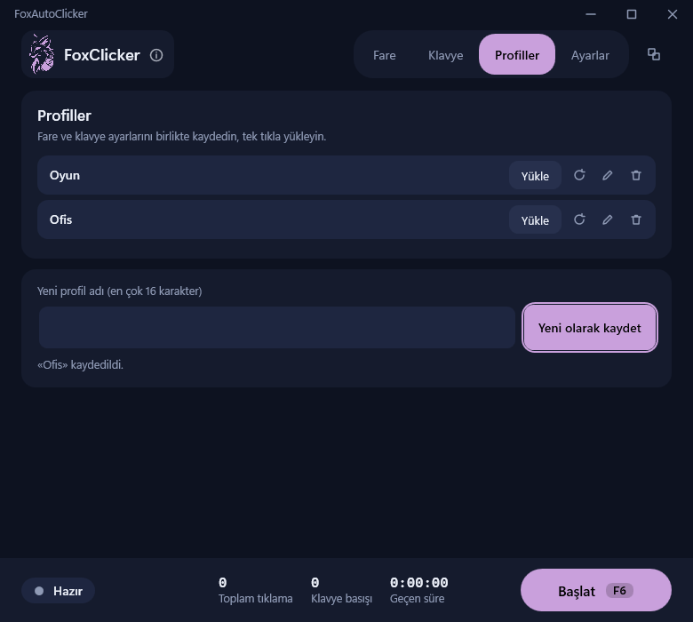
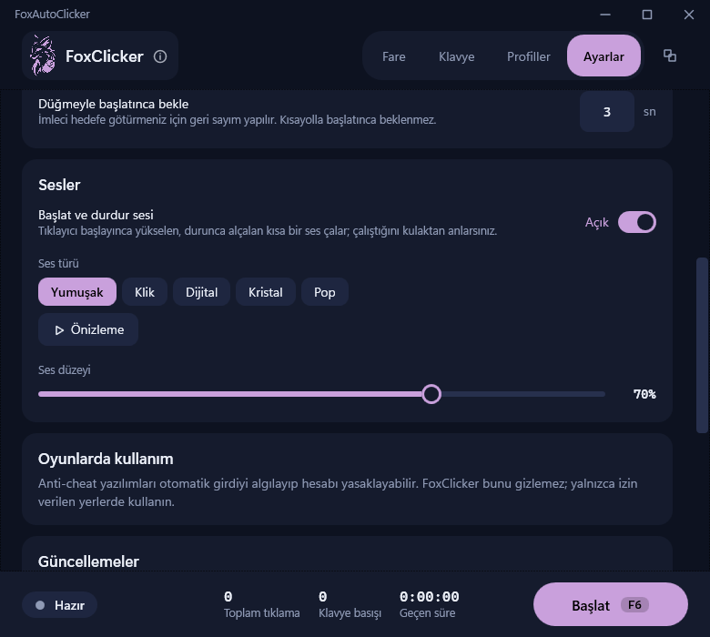
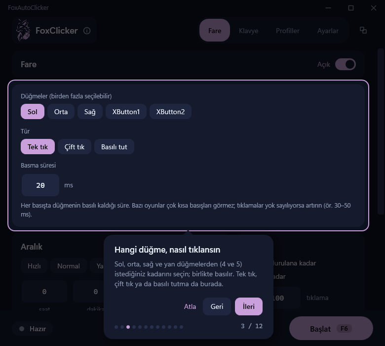
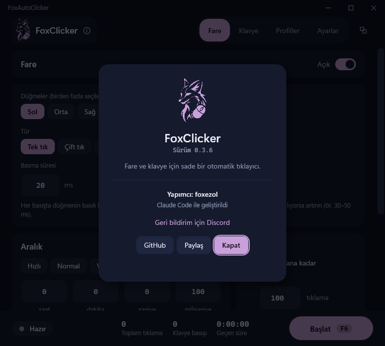

<div align="center">

# FoxClicker

**Windows için fare ve klavye otomatik tıklayıcısı: sade, görünüşü güzel.**

[English](README.md) · Türkçe

[**Son sürümü indir**](https://github.com/foxezol/foxautoclicker/releases/latest)


</div>

## Özellikler

**Fare**
- Sol, orta, sağ ve iki yan düğme (4 ve 5): istediğiniz kombinasyonu seçin, birlikte basılır. Tek tık, çift tık ya da **basılı tutma**
- Saatten milisaniyeye aralık; **Hızlı / Normal / Yavaş** ön ayarları (50 ms, 250 ms, 1 sn) ya da istediğiniz özel değer
- Ritmi doğal göstermek için isteğe bağlı rastgele sapma
- Durdurulana kadar ya da belirli sayıda tekrar
- İmlecin olduğu yerde ya da sabit bir konumda tıklama. **Konum seç**, ekranı karartıp her kenardan imlecinize uzanan kılavuz çizgileri çizer; tıklayınca seçilir, Esc iptal eder

**Klavye**
- Tuş dizisini tek tek ekleyin ya da **Tuş kaydını başlat**'a basıp yazarak kaydedin
- Diziyi düzenleyin: tuşu sola/sağa taşıyın, silin, sonuncuyu geri alın, hepsini temizleyin. Uygulamanın kendi kısayolu asla kaydedilmez
- **Bas ve bırak** (her turda dizinin tamamı çalışır) ya da durdurana kadar **basılı tut**
- Fareyle aynı aralık ve tekrar seçenekleri

**Diğerleri**
- Başka bir uygulamadayken de çalışan tek bir **başlat/durdur kısayolu** (varsayılan F6; ilk açılışta uygulama onaylamanızı ya da değiştirmenizi ister). *Bas, aç/kapat* ya da *Basılı tuttukça çalışsın* seçilebilir (tuşu tuttuğunuz sürece çalışır). Kısayol bir klavye tuşu ya da **fare yan düğmesi (XButton1/XButton2)** olabilir
- Düğmeyle başlatırken, imleci hedefe götürebilmeniz için görünür bir **geri sayım** (iptal edilebilir)
- Beş stilde **başlat ve durdur sesi** (Yumuşak, Klik, Dijital, Kristal, Pop); önizleme düğmesi ve ses düzeyi kaydırıcısıyla. Çalıştığını kulaktan anlarsınız
- Yeni kullanıcılar için yönlendirmeli **tur**: ekranı karartır, her bölümü çerçeveler ve bir cümleyle anlatır. İstediğiniz zaman Ayarlar'dan yeniden başlatabilirsiniz
- **Profiller**: fare ve klavye ayarlarını birlikte kaydedin, tek tıkla yükleyin
- Aynı kontrolleri ve sayaçları taşıyan, her zaman üstte duran küçük **mini pencere**
- Koyu ve açık tema, varsayılan olarak lavanta vurgu, turuncu ya da **renk çarkından** veya `#RRGGBB` kodundan istediğiniz renk. Pencere ve görev çubuğu simgesi vurguyu izler
- Türkçe ve İngilizce
- GitHub Releases üzerinden **otomatik güncelleme**; *Şimdi güncelle / Daha sonra* sorusuyla
- Ayarlar'da **Ayarları sıfırla** ve **Uygulamayı kaldır** düğmeleri

<div align="center">






</div>

## Kurulum

[Son sürümden](https://github.com/foxezol/foxautoclicker/releases/latest) şunlardan birini indirin:

| Dosya | Nedir |
|---|---|
| `FoxClicker-Setup-x.y.z.exe` | Kurulum sihirbazı. Kurulum klasörünü, Başlat Menüsü klasörünü ve masaüstü kısayolu eklenip eklenmeyeceğini seçersiniz. Son sayfada *FoxClicker'ı çalıştır* ve *FoxClicker'ın GitHub sayfasını aç* kutuları işaretli gelir; istemediğinizi kaldırın. "Tüm kullanıcılar için" kurulumu seçmedikçe yönetici izni gerekmez. |
| `FoxClicker-Portable-x.y.z.zip` | Taşınabilir. İstediğiniz yere açın, `FoxAutoClicker.exe`'yi çalıştırın. |

Windows 10 ya da 11 (64 bit). .NET çalışma zamanı pakete dahil, ayrıca bir şey kurmanız gerekmez.

> Yükleyici kod imzalı olmadığı için Windows SmartScreen ilk açılışta uyarı verebilir.
> **Ek bilgi**'ye, sonra **Yine de çalıştır**'a tıklayın.

## Kullanım

1. **Fare**, **Klavye** ya da ikisini seçin. Her sekmenin sağ üstündeki anahtarı kullanın.
2. Aralığı, tıklanacak yeri ya da basılacak tuşları ayarlayın.
3. **F6**'ya (ya da Başlat düğmesine) basın. Durdurmak için yeniden basın.

Ayarlar `%AppData%\FoxAutoClicker\settings.json` dosyasında saklanır.

## Güncellemeler

**Ayarlar → Güncellemeler** bölümünden açılışta otomatik kontrolü açabilir ya da elle kontrol edebilirsiniz. Yeni sürüm yayımlanınca FoxClicker şimdi mi yoksa daha sonra mı güncellemek istediğinizi sorar.

- **Setup ile kurulduysa:** *Şimdi güncelle* yeni yükleyiciyi indirip sessizce çalıştırır, sonra FoxClicker yeniden açılır.
- **Taşınabilir sürümde:** uygulama yeni sürümü haber verir, *Sürüm sayfasını aç* sizi indirmeye götürür.

## Oyunlar hakkında

Birçok çevrimiçi oyun ve anti-cheat sistemi otomatik girdiyi algılayıp hesabı yasaklayabilir. FoxClicker kendini gizlemez. Yalnızca otomasyona izin verilen yerlerde kullanın.

## Kaynaktan derleme

[.NET 10 SDK](https://dotnet.microsoft.com/download) gerekir.

```powershell
git clone https://github.com/foxezol/foxautoclicker
cd foxautoclicker
dotnet run -c Release
```

Yükleyiciyi derlemek için ayrıca [Inno Setup 6](https://jrsoftware.org/isinfo.php) gerekir:

```powershell
dotnet publish -c Release -r win-x64 --self-contained -p:PublishReadyToRun=true -o publish
ISCC.exe /DMyAppVersion=0.3.6 installer\FoxClicker.iss     # Releases\FoxClicker-Setup-0.3.6.exe
```

Taşınabilir zip için `publish` klasörünün içeriğini `FoxClicker-Portable-0.3.6.zip` olarak sıkıştırın. İki dosyayı `v0.3.6` etiketli bir GitHub sürümüne ekleyin; kurulu kopyalar güncellemeyi sürümdeki `*Setup*.exe` dosyasından bulur.

## Emeği geçenler

[foxezol](https://github.com/foxezol) tarafından yapıldı, Claude Code ile geliştirildi.

Geri bildirim ve fikirler için [Discord](https://discord.com/users/381533632852131841) ya da [GitHub issue](https://github.com/foxezol/foxautoclicker/issues).

## Lisans

[LICENSE](LICENSE) dosyasına bakın.
