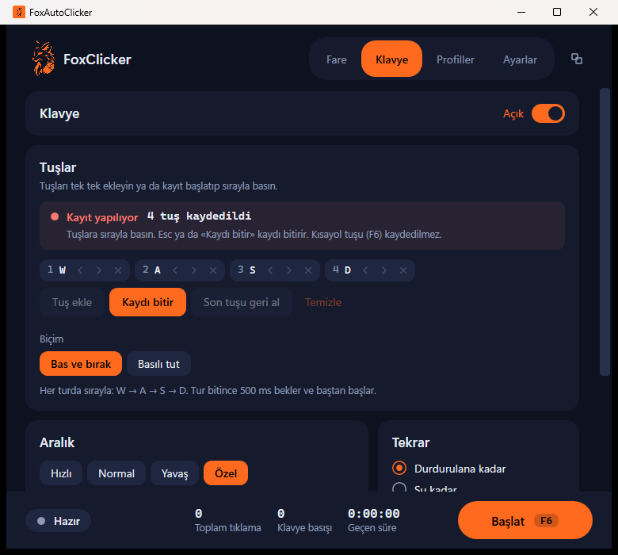
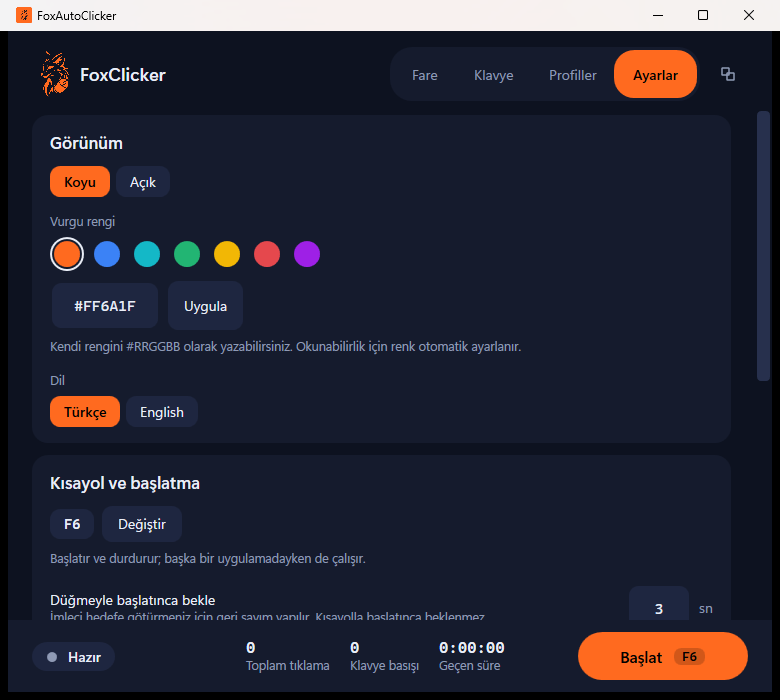
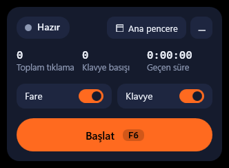

<div align="center">

# FoxClicker

**Windows için fare ve klavye otomatik tıklayıcısı: sade, görünüşü güzel.**

[English](README.md) · Türkçe

[**Son sürümü indir**](https://github.com/foxezol/foxautoclicker/releases/latest)


</div>

## Özellikler

**Fare**
- Sol, orta ya da sağ düğme; tek tık, çift tık ya da **basılı tutma**
- Saatten milisaniyeye aralık; **Hızlı / Normal / Yavaş** ön ayarları (50 ms, 250 ms, 1 sn) ya da istediğiniz özel değer
- Ritmi doğal göstermek için isteğe bağlı rastgele sapma
- Durdurulana kadar ya da belirli sayıda tekrar
- İmlecin olduğu yerde ya da sabit bir konumda tıklama. **Konum seç**, ekranı karartıp her kenardan imlecinize uzanan kılavuz çizgileri çizer; tıklayınca seçilir, Esc iptal eder

**Klavye**
- Tuş dizisini tek tek ekleyin ya da **Tuş kaydını başlat**'a basıp yazarak kaydedin
- Diziyi düzenleyin: tuşu sola/sağa taşıyın, silin, sonuncuyu geri alın, hepsini temizleyin. Uygulamanın kendi kısayolu asla kaydedilmez
- **Bas ve bırak** (her turda dizinin tamamı çalışır) ya da durdurana kadar **basılı tut**
- Fareyle aynı aralık ve tekrar seçenekleri

**Diğerleri**
- Başka bir uygulamadayken de çalışan tek bir **başlat/durdur kısayolu** (varsayılan F6, değiştirilebilir)
- Düğmeyle başlatırken, imleci hedefe götürebilmeniz için görünür bir **geri sayım** (iptal edilebilir)
- Çalıştığını kulaktan anlamanız için kısa **başlat ve durdur sesleri**
- **Profiller**: fare ve klavye ayarlarını birlikte kaydedin, tek tıkla yükleyin
- Aynı kontrolleri ve sayaçları taşıyan, her zaman üstte duran küçük **mini pencere**
- Koyu ve açık tema, yedi vurgu rengi ya da kendi `#RRGGBB` renginiz
- Türkçe ve İngilizce
- GitHub Releases üzerinden **otomatik güncelleme**; *Şimdi güncelle / Daha sonra* sorusuyla

<div align="center">




</div>

## Kurulum

[Son sürümden](https://github.com/foxezol/foxautoclicker/releases/latest) şunlardan birini indirin:

| Dosya | Nedir |
|---|---|
| `FoxClicker-win-Setup.exe` | Yükleyici. Kullanıcınıza kurar (yönetici izni gerekmez), kısayollar ekler ve kendini güncel tutar. |
| `FoxClicker-win-Portable.zip` | Taşınabilir. İstediğiniz yere açın, `FoxClicker.exe`'yi çalıştırın. Güncelleme burada da çalışır. |

Windows 10 ya da 11 (64 bit). .NET çalışma zamanı pakete dahil, ayrıca bir şey kurmanız gerekmez.

> Yükleyici kod imzalı olmadığı için Windows SmartScreen ilk açılışta uyarı verebilir.
> **Ek bilgi**'ye, sonra **Yine de çalıştır**'a tıklayın.

## Kullanım

1. **Fare**, **Klavye** ya da ikisini seçin. Her sekmenin sağ üstündeki anahtarı kullanın.
2. Aralığı, tıklanacak yeri ya da basılacak tuşları ayarlayın.
3. **F6**'ya (ya da Başlat düğmesine) basın. Durdurmak için yeniden basın.

Ayarlar `%AppData%\FoxAutoClicker\settings.json` dosyasında saklanır.

## Güncellemeler

**Ayarlar → Güncellemeler** bölümünden açılışta otomatik kontrolü açabilir ya da elle kontrol edebilirsiniz. Yeni sürüm yayımlanınca FoxClicker şimdi mi yoksa daha sonra mı güncellemek istediğinizi sorar. Güncelleme yeni sürümü indirir ve uygulamayı yeniden başlatır.

## Oyunlar hakkında

Birçok çevrimiçi oyun ve anti-cheat sistemi otomatik girdiyi algılayıp hesabı yasaklayabilir. FoxClicker kendini gizlemez. Yalnızca otomasyona izin verilen yerlerde kullanın.

## Kaynaktan derleme

[.NET 10 SDK](https://dotnet.microsoft.com/download) gerekir.

```powershell
git clone https://github.com/foxezol/foxautoclicker
cd foxautoclicker
dotnet run -c Release
```

Yükleyici ve taşınabilir zip için ([Velopack](https://velopack.io)):

```powershell
dotnet publish -c Release -r win-x64 --self-contained -p:PublishReadyToRun=true -o publish
dotnet tool install -g vpk
vpk pack --packId FoxClicker --packVersion 0.3.0 --packDir publish --mainExe FoxAutoClicker.exe --icon Assets/app.ico --runtime win-x64 --outputDir Releases
```

`Releases/` içindeki her şeyi `v0.3.0` etiketli bir GitHub sürümüne yükleyin; böylece kurulu kopyalar güncellemeyi bulabilir.

## Emeği geçenler

[foxezol](https://github.com/foxezol) tarafından yapıldı, Claude Code ile geliştirildi.

## Lisans

[LICENSE](LICENSE) dosyasına bakın.
